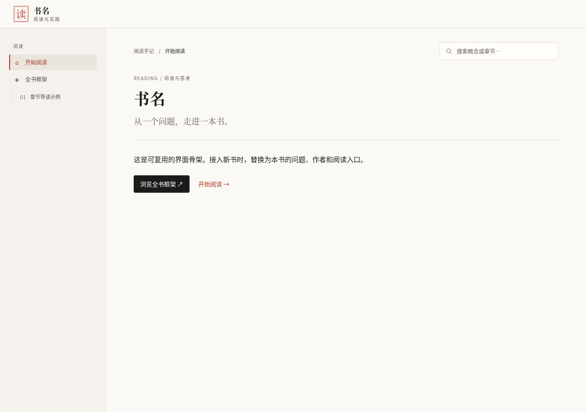

# 书籍转学习网页 · 读书智能体

把一本书或读书笔记，整理成**可离线打开、可追溯出处**的学习网页。  
当前以 Codex 技能包形式发布，按智能体方式完成：范围核对 → 结构梳理 → 覆盖审查 → 页面生成 → 验收。

[](https://github.com/brucegu17/book-to-learning-html/releases)
[](./LICENSE)
[](#快速开始)



## 为什么做这个

读书常见的问题不是没读，而是：读完说不清、找不到出处、方法用不上。  
这个智能体把阅读过程变成一份可检查的学习成果：

- **读懂**：章节导读、全书结构、概念关系
- **检验**：覆盖审查、自测与练习
- **应用**：方法卡写清依据、情境、步骤与边界

## 你会得到什么

| 交付物 | 内容 |
|---|---|
| 离线学习网页 | 导航、搜索、章节导读、方法卡、练习、自测 |
| 分章笔记 | 核心问题、论证、概念、方法、条件、反例 |
| 覆盖表 | 原书范围、要点去向、缺口与审查记录 |
| 验收记录 | 做过的检查，以及还没验证的部分 |

## 快速开始

### 1. 下载

- [下载 v1.3 智能体包](https://github.com/brucegu17/book-to-learning-html/releases/latest)
- 或直接取仓库中的 `book-to-learning-html-v1.3-agent.zip`

### 2. 装进 Codex

```sh
unzip book-to-learning-html-v1.3-agent.zip -d ~/.codex/skills
```

也可以解压到你的项目 `skills/` 目录。

### 3. 对它说

> 把这本书做成学习网页，要求内容可追溯，给我方法卡和练习。

也支持：已有读书笔记转网页、只做覆盖审查、改版现有学习页。

## 四种工作模式

| 模式 | 适合什么时候 |
|---|---|
| 新书整理 | 从原书开始做完整学习页 |
| 知识库转网页 | 已有读书笔记，想变成可阅读页面 |
| 网页改版修复 | 保留内容和数据，只改呈现或修问题 |
| 仅覆盖审查 | 只要知道哪些内容漏了、去向在哪里 |

## 知识产权声明

本项目**只是辅助阅读与学习的工具**，不提供、不托管受版权保护的书籍原文。

- 书请自己合法获得。
- 生成内容用于个人学习；请尊重原书版权，不要传播原文或未授权摘录。
- 仓库和发布包**不含任何图书原文**，示例均为虚构内容。
- 处理某本书，并不转移或削弱作者与出版方的权利。

## 验证情况

v1.3 已完成：

- 16 项覆盖审查脚本测试
- 20 项 Chromium 界面检查
- 包内容与源文件一致性检查

详见 [v1.3 验证记录](./docs/v1.3-validation.json)。Safari、Firefox 和真实手机触控尚未测试。

## 参与共建

欢迎读书、学习产品和工具实践有经验的朋友一起参与：

- 提 Issue：使用体验、缺陷、需求
- 提 PR：修 bug、改说明、补测试
- 分享虚构或自有版权的示例

请先看 [CONTRIBUTING.md](./CONTRIBUTING.md)。

## 许可

代码与说明文件以 [MIT License](./LICENSE) 发布。  
你处理的书籍内容仍受原有版权约束。
